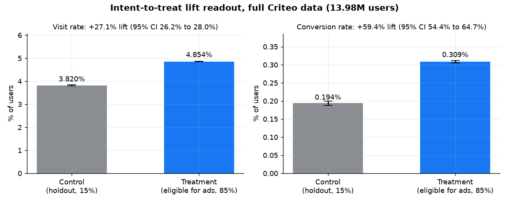
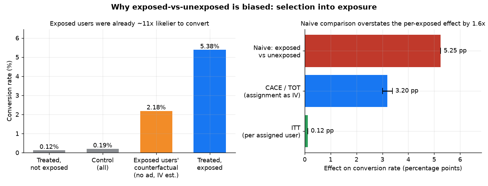
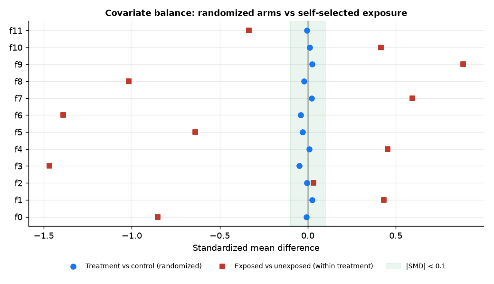
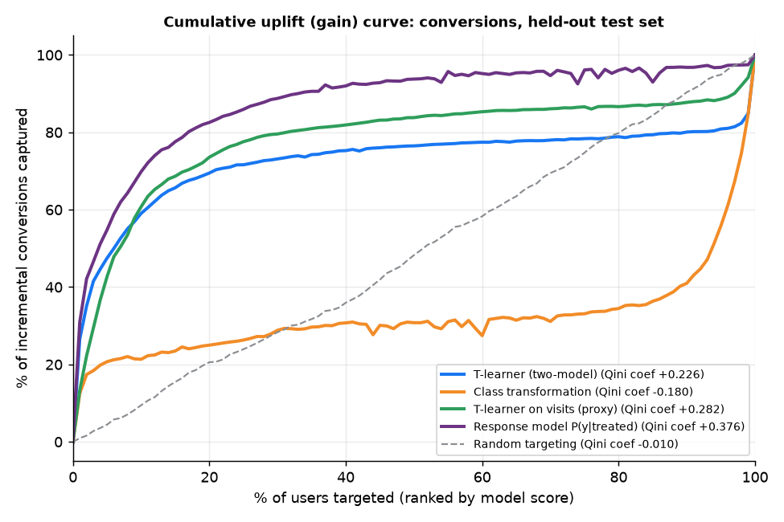
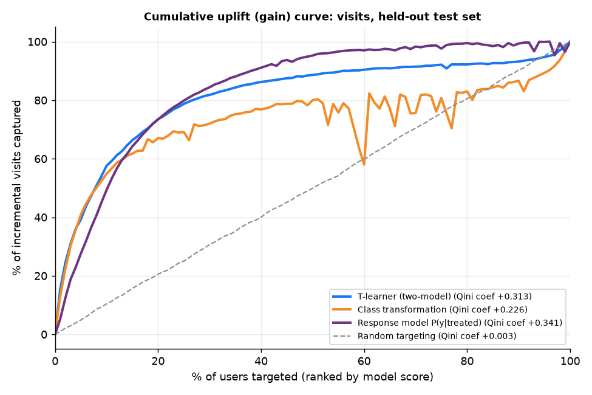
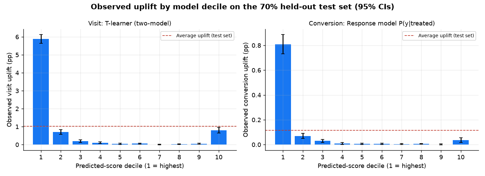
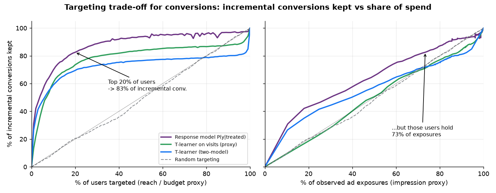

# Ads Incrementality & Conversion Lift Measurement

**Did the ads cause the conversions, or would those users have converted anyway?** This project runs a full
Conversion-Lift-style readout on 13.98M users from a real randomized ad holdout test (the public Criteo Uplift
dataset), then asks the targeting question that follows: *who* should an advertiser actually spend on?

> Public data, independent portfolio project; not affiliated with or endorsed by Meta or Criteo.



## The business problem

Ads platforms such as Meta's run **Conversion Lift** studies: a random slice of the target audience is held out
from seeing an advertiser's ads, and conversions in the eligible (test) group are compared with the holdout.
The difference is the *incremental* effect, the conversions the ads actually caused, which last-click
attribution can't separate from conversions that would have happened anyway.

Three questions an advertiser (and the ads measurement team) need answered:

1. **Lift readout.** How many incremental visits and conversions did the campaign cause, with what uncertainty?
2. **Per-exposure effect.** Only some eligible users were actually served an ad. What is the effect on the
   people who were *reached*, and why can't we just compare exposed with unexposed users?
3. **Targeting.** Is the effect concentrated? If the advertiser only targets the top-k% of users by predicted
   uplift, what share of incremental conversions do they keep, and at what share of spend?

## Data

**Criteo Uplift Prediction Dataset v2.1** by Criteo AI Lab:
E. Diemert, A. Betlei, C. Renaudin, M.-R. Amini, *"A Large Scale Benchmark for Uplift Modeling"*,
AdKDD & TargetAd Workshop, KDD 2018. Dataset page: <https://ailab.criteo.com/criteo-uplift-prediction-dataset/>;
mirror used here: <https://huggingface.co/datasets/criteo/criteo-uplift>.
**License: CC BY-NC-SA 4.0** (attribution, non-commercial, share-alike). Credit to Criteo AI Lab.

- 13,979,592 rows, one per user: 12 anonymized dense features (`f0`–`f11`), `treatment` (1 = eligible for ads,
  0 = randomized holdout), `exposure` (actually served an ad), `visit`, `conversion`.
- Treatment ratio is 85/15 by design.
- **The full dataset is used for every result below; nothing is sampled.** Raw data is not committed;
  `scripts/download_data.py` fetches it (~311 MB) and converts it to Parquet.
- Criteo's caveats (from the dataset card): the data assembles *several* incrementality tests and was
  **sub-sampled non-uniformly for privacy**, so absolute lift levels are not Criteo's real incrementality, and
  features are randomly projected. Treat the numbers as a realistic benchmark, not a statement about any advertiser.

## Method

| Step | What | Where |
|---|---|---|
| Metric layer | Arm sizes and SRM, lift readout with Wald CIs, compliance, naive comparison, Wald IV estimate, covariate balance, visit→conversion funnel, all in SQL run through DuckDB | `sql/*.sql`, `src/run_sql.py` |
| Lift readout | Two-proportion z-tests, Wald CI on the difference, log CI on the ratio, incremental outcomes per 1M users, chi-square sample-ratio check against 85/15 | `src/lift_readout.py` |
| ITT vs exposure | CACE / treatment-on-treated via **assignment as an instrument for exposure** (Wald estimator, delta-method SE including the outcome–exposure covariance). Control can't be exposed (one-sided non-compliance), so CACE = effect on the treated who were exposed | `src/lift_readout.py` |
| Variance reduction | Regression-adjusted ITT (CUPED-style) on the 12 pre-treatment features, HC1 robust SEs computed in chunks | `src/lift_readout.py` |
| Heterogeneous effects | 30% train / 70% test split, stratified by treatment (seed 42). **T-learner** (two `HistGradientBoostingClassifier`s, one per arm) and **class transformation** (Jaskowski & Jaroszewicz 2012, reweighted from 85/15 to an effective 50/50, uplift = 2·P(Z=1)−1). Baselines: a **response model** P(y \| treated), i.e. "target likely converters", and random | `src/uplift_models.py` |
| Evaluation | Cumulative uplift (gain) curves, Qini curves, a normalized Qini coefficient (area between the model's gain curve and random, as a share of total incremental outcomes), observed uplift by decile with 95% CIs, top-k targeting trade-off under two spend proxies | `src/evaluate_uplift.py` |

All models and settings were fixed before looking at test results; nothing was tuned on the test set.

## Key results (all numbers from the code in this repo)

### 1. Lift readout (intent-to-treat, 13.98M users)

| Metric | Holdout (n = 2,096,937) | Eligible for ads (n = 11,882,655) | Absolute lift (95% CI) | Relative lift (95% CI) | Incremental per 1M users |
|---|---|---|---|---|---|
| Visit | 3.820% | 4.854% | **+1.034 pp** (1.006–1.063) | **+27.1%** (26.2–28.0%) | 10,342 visits |
| Conversion | 0.194% | 0.309% | **+0.115 pp** (0.108–0.122) | **+59.4%** (54.4–64.7%) | **1,152 conversions** (1,085–1,219) |

- Both effects are highly significant (visit z = 65.2; conversion z = 28.5, p ≈ 7e-179).
- Sample-ratio check: treatment share 0.8500001 vs the 0.85 design (χ² p = 0.999), so no SRM.
- Scaled to the whole eligible arm, that is about 13,700 conversions the campaign caused.
- Funnel (SQL 07): ads raise both visit rate and conversion per visit (5.07% → 6.36%).

### 2. ITT vs exposure, and why exposed-vs-unexposed is biased



- Only **3.60%** of eligible users (428,212) were actually served an ad; no holdout user was.
- **Per-exposed effect (CACE via IV): +3.20 pp conversion (95% CI 3.01–3.38)** and +28.7 pp visit (27.9–29.5).
  Exposed users convert at 5.38%; the IV estimate of their no-ad baseline is 2.18%, so ads lifted the reached
  users' conversion rate by **+146%**.
- **The naive comparison** (exposed 5.38% vs unexposed 0.131%) says +5.25 pp, a "41x" difference. That
  overstates the true per-exposed effect by **1.6x**, and in relative terms (+4,008% vs +146%) by far more.
- Why: exposure isn't random. The ad system delivers to high-intent users, whose baseline conversion
  (2.18%) is about 11x the holdout's (0.194%). Eligible-but-unexposed users convert *below* the holdout (0.119%)
  because the high-intent users were pulled out of their group. Feature balance shows it directly: randomized arms
  differ by |SMD| ≤ 0.05 on every feature, while exposed vs unexposed differ by up to 1.47 SD.



**A robustness flag worth stating:** with 14M rows, even the small arm differences (|SMD| ≤ 0.05) aren't pure
noise. They're consistent with Criteo pooling several tests and sub-sampling non-uniformly. Adjusting for the
pre-treatment features lowers the ITT estimates to **+0.092 pp conversion** (from 0.115) and **+0.698 pp visit**
(from 1.034), with 12% and 26% variance reduction respectively. In a real study I would stratify by test and
report the adjusted figure; here I report the unadjusted readout as the headline and **0.092–0.115 pp** as the
plausible range for conversion lift.

### 3. Heterogeneous effects: who is incremental?

Held-out test set: 9,785,715 users.

| Model | Qini coef. (conversion) | Top 10%: share of incremental conversions | Top 20% | Qini coef. (visit) | Top 10%: share of incremental visits | Top 20% |
|---|---|---|---|---|---|---|
| Response model P(y \| treated) | **0.376** | **69.8%** | **82.6%** | **0.341** | 49.3% | 73.4% |
| T-learner (two-model) | 0.226 | 59.0% | 69.5% | 0.313 | **57.6%** | **73.5%** |
| T-learner trained on visits (proxy) | 0.282 | 60.8% | 73.6% | n/a | n/a | n/a |
| Class transformation | −0.180 | 21.3% | 25.0% | 0.226 | 54.8% | 67.1% |
| Random | −0.010 | 9.5% | 20.6% | 0.003 | 10.4% | 20.6% |




- **The effect is highly concentrated.** Top decile by T-learner (visits): +5.88 pp uplift (95% CI 5.64–6.12),
  5.8x the average. Top decile by response model (conversions): +0.81 pp (0.73–0.89), 7.0x the average.
- **No "sleeping dogs":** no decile shows a meaningfully negative effect, so the ads don't appear to hurt any segment.
- **For rare conversions (0.29%), dedicated uplift models lose to a simple response model.** Uplift here
  rises with baseline intent (reached users are high-intent users), and the two-model *difference* gets noisy in
  high-baseline segments. The T-learner's bottom decile still has +0.23 pp uplift, twice the average, so it is
  mis-ranking real responders. Class transformation fails outright on conversions (negative Qini) with an 85/15
  split and only 2,822 holdout conversions in the test set.
- **For denser visits (4.7%), the T-learner wins at the narrow end** (top 10%: 57.6% vs 49.3% for the
  response model), and the gap closes by 20%.



### 4. Business framing: target the top-k%



Ranking users by the best conversion model (response model):

| Target top-k% of users | Incremental conversions kept | Share of users (reach-priced spend) | Share of observed ad exposures (impression-priced spend) |
|---|---|---|---|
| 10% | 69.8% | 10% | 54.2% |
| 20% | 82.6% | 20% | 73.3% |
| 30% | 88.8% | 30% | 82.4% |
| 50% | 93.8% | 50% | 95.3% |

- If cost scales with **users reached**, targeting the top 20% keeps **83% of incremental conversions for 20%
  of spend**, about 4x more incremental conversions per dollar. 90% is kept at the top 33%.
- If cost scales with **impressions**, the gain is much smaller. Those same top-20% users already received
  73% of the exposures, because delivery already favors high-intent users. That's 83% of incremental conversions
  for 73% of impressions, roughly a **13% better cost per incremental conversion**.
- The class-transformation visit model stands out on this axis: its top 20% captures 67% of incremental visits
  with only 45% of exposures (1.5x per impression), so it finds responsive users the delivery system under-serves.

## Recommendation

1. **Report ITT as the campaign's lift and CACE as the per-reached-user effect. Never use exposed vs unexposed**
   as a lift estimate: here it overstated the per-exposed effect by 1.6x and implied a 41x lift.
2. **Show the covariate-adjusted lift alongside the raw readout** when arms pool several tests. Here it moves
   conversion lift from 0.115 to 0.092 pp and cuts variance 12–26%, which shortens future tests.
3. **For conversion-optimized targeting, start from a response ranking (or a visit-trained uplift model), not
   a direct conversion uplift model.** With an outcome this rare, a strong baseline beats the fancier estimator.
4. **Size the savings on the right cost basis.** "Top 20% keeps 83%" is a 4x efficiency gain on reach but only
   about 13% on impressions. Before reallocating budget, validate the targeted strategy with a fresh holdout lift
   test on the targeted segment.

## How to run

```bash
python -m venv .venv && source .venv/bin/activate
pip install -r requirements.txt
bash scripts/run_all.sh          # download -> SQL -> readout -> models -> evaluation -> figures (~6-8 min, 8 GB RAM)
```

Optional: `python scripts/download_data.py --sample 2000000` builds a reproducible 2M-row random sample
(seed 42) for smaller machines. Results in this README use the full 13.98M rows.

```
sql/                 DuckDB metric queries (00_view.sql defines the view over the Parquet file)
src/run_sql.py       runs every query, writes results/sql/*.csv
src/lift_readout.py  ITT, CIs, SRM, balance, CACE via IV, regression adjustment -> results/lift_readout.json
src/uplift_models.py T-learner + class transformation (+ response baseline), stepwise CLI
src/evaluate_uplift.py gain / Qini curves, deciles, top-k trade-off -> results/uplift_eval.json
src/make_figures.py  figures/*.png
scripts/             download_data.py, run_all.sh
```

## Limitations

- Criteo's non-uniform sub-sampling means absolute lift levels are not real-world incrementality; relative
  comparisons between methods are the point.
- Spend proxies are approximations. Real costs depend on auction dynamics, and exposure under a new targeting
  policy would differ from the exposure observed in this test.
- Features are anonymized projections, so segments can't be described in business terms (age, interests, etc.).
- The CACE assumes the instrument only affects outcomes through exposure (exclusion restriction), which is
  standard for ad holdouts but untestable.

## License

Code: MIT (see `LICENSE`). Data: CC BY-NC-SA 4.0, © Criteo, not redistributed here.
